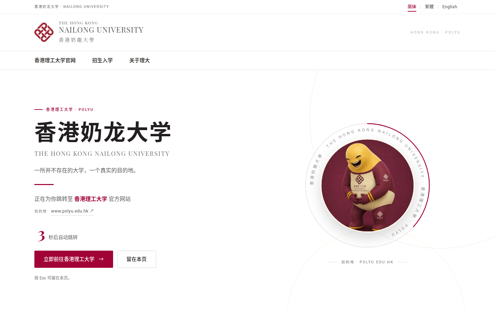

# 香港奶龍大學 · The Hong Kong Nailong University

一个趣味跳转站：打开 **香港奶龙大学.com**，先加载这页，然后自动把你送到
[香港理工大学（PolyU）](https://www.polyu.edu.hk/) 的官方网站。界面仿照 PolyU 的视觉风格，
提供**简体中文 / 繁體中文 / English** 三语切换，并会跳转到对应语言的官网版本。



## 功能

- **加载即跳转**：进度环与时序动画结束后自动前往 PolyU 官网（默认 4 秒），可随时按
  `Esc`、点击「留在本页」或向下滚动来取消。
- **三语界面**：简中 / 繁中 / 英文即时切换，写入 URL（`?lang=zh-hant`）与
  `localStorage`，刷新后保持。
- **跳转到对应语言**：简中 → `/sc/`，繁中 → `/tc/`，英文 → `/`。
- **PolyU 风格**：品牌红 `#a20337`、Roboto + Playfair Display 字体、衬线校名、细线分隔、
  全幅留白；吉祥物使用 `assets/img/naiwa.jpg`，页头与站点图标使用 PolyU 校徽。
- **可访问**：键盘可达、`prefers-reduced-motion` 支持、语义化结构、跳过导航链接、
  `aria-pressed` 语言状态与 `aria-live` 提示。
- **零依赖、零构建**：纯静态 HTML/CSS/JS，字体与图片全部自托管，无外部请求。
- **默认不被搜索引擎收录**：`robots.txt` + `meta robots=noindex`。

## 本地预览

只需要 Node.js 18+（或任何静态服务器）：

```bash
npm run preview        # http://127.0.0.1:4173/
npm run check          # 校验三语文案完整性、资源引用与跳转时长
```

预览参数：

| 参数 | 作用 |
| --- | --- |
| `?lang=zh-hans` / `zh-hant` / `en` | 指定界面语言 |
| `?stay` | 不自动跳转，方便截图或演示 |
| `?lang=en&stay` | 英文界面 + 停留 |

## 目录结构

```text
.
├── index.html                  # 单页：头图与自动跳转
├── assets/
│   ├── css/style.css           # PolyU 风格样式与响应式
│   ├── js/lang.js              # 首屏前确定语言，避免闪错语言
│   ├── js/i18n.js              # 三语文案（改文案只需改这里）
│   ├── js/app.js               # 倒计时、取消跳转、语言切换
│   ├── img/                    # 校徽、吉祥物、OG 图等
│   └── fonts/                  # Roboto / Playfair Display（含许可证）
├── scripts/serve.mjs           # 本地静态服务器（无依赖）
├── scripts/check.mjs           # 文案/资源/时序检查
├── deploy/nginx-http.conf      # 首次申请证书用的 80 端口配置
├── deploy/nginx.conf           # 生产 HTTPS 配置
├── site.webmanifest
├── robots.txt
└── docs/preview.png
```

## 部署到现有服务器（Nginx）

站点是纯静态文件，放在任意 Web 根目录即可，**必须部署在域名根路径**（资源使用 `/assets/...`
绝对路径）。以下以 `/var/www/nailong` 与 Nginx 为例。

### 1. 上传文件

```bash
rsync -avz \
  --exclude .git --exclude .refs --exclude node_modules \
  ./ user@your-server:/var/www/nailong/
```

然后在服务器上把目录交给 Web 服务器用户（Debian/Ubuntu 的 Nginx 通常是 `www-data`，
其他发行版可能是 `nginx` 或 `httpd`）：

```bash
sudo chown -R www-data:www-data /var/www/nailong
```

### 2. 配置域名与 DNS

域名为 **香港奶龙大学.com**，其 punycode 是 `xn--psszg58csy9ayt3cnsh.com`。

在 DNS 服务商处添加：

| 类型 | 主机记录 | 值 |
| --- | --- | --- |
| A | `@`（或 `xn--psszg58csy9ayt3cnsh`） | 服务器 IPv4 |
| AAAA（可选） | `@` | 服务器 IPv6 |
| CNAME（可选） | `www` | `xn--psszg58csy9ayt3cnsh.com` |

> 多数 DNS 面板支持直接输入中文域名，会自动转换为 punycode。若你的面板只接受 ASCII，
> 请填写 `xn--psszg58csy9ayt3cnsh.com`。

### 3. 先申请证书（80 端口）

复制 `deploy/nginx-http.conf` 到 `/etc/nginx/sites-available/nailong.conf`，建立软链接并重载：

```bash
sudo ln -s /etc/nginx/sites-available/nailong.conf /etc/nginx/sites-enabled/
sudo nginx -t && sudo systemctl reload nginx
sudo certbot certonly --webroot -w /var/www/nailong \
  -d xn--psszg58csy9ayt3cnsh.com -d www.xn--psszg58csy9ayt3cnsh.com
```

### 4. 切换到 HTTPS 配置

用 `deploy/nginx.conf` 覆盖刚才的配置（证书路径默认为
`/etc/letsencrypt/live/xn--psszg58csy9ayt3cnsh.com/`，如有不同请修改），然后：

```bash
sudo nginx -t && sudo systemctl reload nginx
curl -I https://xn--psszg58csy9ayt3cnsh.com/
```

配置文件已包含：

- HTTP → HTTPS 301，`www` → 裸域 301
- HSTS、CSP（仅允许同源脚本/样式/字体）、`X-Content-Type-Options`、
  `Referrer-Policy`、`X-Frame-Options`、`Permissions-Policy`
- 任意路径回退到 `index.html`（单页站）
- `index.html` 不缓存，静态资源缓存 7 天，gzip

### 5. 如果想同时启用繁体域名

`香港奶龍大學.com`（`xn--psszg50dqw9ayt3clqh.com`）是另一个 IDN。若已注册，把它加入
`server_name` 并在证书中追加该域名即可；`deploy/nginx.conf` 内已留注释位置。

### 其他服务器

没有 Nginx 也可以：Apache、Caddy、Vercel/Netlify、对象存储静态托管都能直接使用，
只需要「所有路径回退到 `index.html`」与「`/assets` 可访问」两条规则。Caddy 示例：

```caddy
xn--psszg58csy9ayt3cnsh.com, www.xn--psszg58csy9ayt3cnsh.com {
    root * /var/www/nailong
    encode gzip
    try_files {path} /index.html
    file_server
}
```

## 自定义

| 想改什么 | 改哪里 |
| --- | --- |
| 文案 / 三种语言 | `assets/js/i18n.js`，然后 `npm run check` |
| 自动跳转时长 | `assets/js/app.js` 的 `REDIRECT_MS` **和** `assets/css/style.css` 中 `med-fill 4s`（两者会被检查脚本比对） |
| 跳转目标 | `assets/js/i18n.js` 顶部的 `NAILONG_DEST` |
| 品牌色 / 字体 / 间距 | `assets/css/style.css` 顶部的 CSS 变量 |
| 是否允许搜索引擎收录 | 删除 `index.html` 的 `noindex` meta 与 `robots.txt` 的 `Disallow` |

换文案时注意：带 `<span class="nowrap">`、`<strong>` 的条目使用 `data-i18n-html`，其余为
`data-i18n`（纯文本）。`npm run check` 会检查三种语言键值是否齐全、资源是否存在、跳转
时长是否一致。

## 开源与同步

源码仓库：<https://github.com/gengmian/polyu>

```bash
git remote -v            # origin git@github.com:gengmian/polyu.git
git add -A
git commit -m "Update copy"
git push
```

## 权利说明

- 「香港理工大学」「PolyU」、校徽及官网内容的一切权利归香港理工大学所有。
- 「奶龙」形象的相关权利归其权利人所有；吉祥物图片由站点所有者提供。
- 页面内容仅供参考，一切信息以[香港理工大学官网](https://www.polyu.edu.hk/)为准。

## 许可

- 本站代码以 [MIT License](LICENSE) 发布。
- 字体：Roboto 与 Playfair Display 均以 SIL Open Font License 1.1 授权，
  许可证见 `assets/fonts/`。
- 香港理工大学名称、校徽及「奶龙」形象**不在** MIT 许可范围内，权利归各自权利人。
